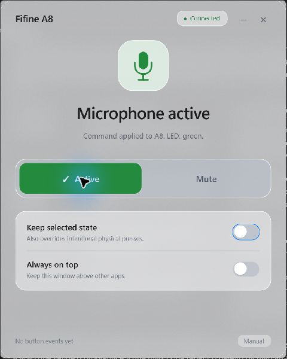
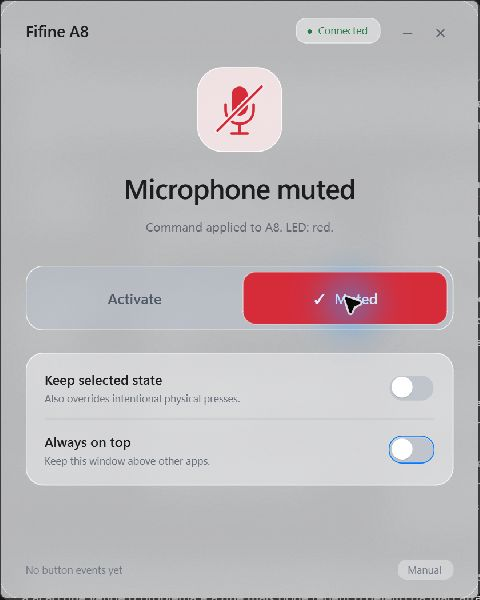

# Fifine A8 Control

**Control the FIFINE A8's mute and LED from a small Windows app.**

[](#compatibility)
[](#installation)
[](LICENSE)
[](https://github.com/VittorGuih/fifine-a8-control/actions/workflows/checks.yml)

The A8's physical mute button can change its LED and cut the microphone while Windows still reports it as unmuted. This app sends a fresh mute command to the A8 and can reapply your selection when the physical button fires again.

> **Experimental:** validated on one FIFINE AmpliGame A8 (`3142:00a8`) running Windows 11. Other devices and firmware revisions have not been verified. This is an independent project, not an official FIFINE application.

<p align="center">
  
  
</p>

## What it does

- **Activate / Mute:** reapply the selected state to the A8, including its physical green/red mute indicator on the tested device.
- **Keep selected state:** respond to incoming button events by restoring your choice.
- **Clear selection:** the state last applied by the app is highlighted; a physical press clears that indication when keep-state is off.
- **Automatic discovery:** match an active Windows capture endpoint to the A8's USB hardware identity. No machine-specific endpoint ID is required.
- **Native Acrylic:** a translucent, blurred Windows interface with an opaque fallback when the effect is unavailable.
- **Always on top:** keep the controls visible while using another application.

No audio is recorded, no audio stream is opened, and the app makes no network requests. Optional diagnostic logs contain control results and button-event timestamps, not audio.

## Compatibility

| Component | Requirement / status |
| --- | --- |
| Operating system | Windows 11 tested; native Windows audio APIs required |
| Device | FIFINE AmpliGame A8, USB vendor `3142`, product `00a8` |
| Python | 3.10 or newer, 64-bit recommended |
| Windows PowerShell | Built-in Windows PowerShell 5.1 |
| Multiple microphones | Connect exactly one A8; the app refuses ambiguous matches |
| Other FIFINE models | Not supported or advertised as compatible |

The AM8 and A8 are different devices. This app does not send AM8 DSP commands, firmware-update requests, or undocumented HID output packets.

## Installation

Install [Python for Windows](https://www.python.org/downloads/windows/) and Git, then run:

```powershell
git clone https://github.com/VittorGuih/fifine-a8-control.git
cd fifine-a8-control
py -3 -m venv .venv
.\.venv\Scripts\python.exe -m pip install .
.\.venv\Scripts\python.exe -m fifine_a8_control
```

There is no need to activate the virtual environment or change your PowerShell execution policy globally. Dependencies are installed into `.venv`.

After installation, double-click **Start.cmd** to open the app without a console window. To create a desktop shortcut:

```powershell
powershell.exe -NoProfile -ExecutionPolicy Bypass -File .\scripts\Create-DesktopShortcut.ps1
```

**Administrator privileges, USBPcap, Wireshark, and replacement USB drivers are not required to run this app.** USB capture tools were used during research only.

## Using it

1. Connect a single A8 directly to your PC.
2. Open the app and wait for **Connected**.
3. Choose **Activate** for green or **Mute** for red.
4. Optionally enable **Keep selected state** if the button is firing unexpectedly.

**Keep selected state also overrides intentional presses of the microphone's physical mute button.** For example, pinning Active will undo an attempt to mute by touching the A8. The option is off whenever the app starts, and it is disabled after a disconnect. Closing the app stops enforcement but leaves the last applied microphone state in place.

The app reacts *after* an event; repeated unwanted activations can still cause brief audio interruptions. It does not repair the capacitive button, USB connection, or electrical interference.

### What the selected state means

The highlighted choice means **the last command successfully applied by this app**. The A8's observed button report does not include an absolute green/red state. If you press the physical button with keep-state off, the app removes its selection and asks you to reapply a choice rather than guess the LED color.

The app briefly sets the input level to zero while reapplying mute, then restores the previous level. This allows a command to reach the hardware even when Windows already has the requested value cached. The intermediate state can produce a brief LED flicker. Keep-state is a convenience feature, not a guarantee against momentary audio transmission.

## Read-only diagnostics

```powershell
.\.venv\Scripts\fifine-a8-inspect.exe
.\.venv\Scripts\fifine-a8-inspect.exe --json
```

These commands discover the A8 and read Windows' cached mute and volume. They do **not** change audio settings and are not a physical LED readout.

To enable local event logging:

```powershell
.\.venv\Scripts\python.exe -m fifine_a8_control --debug
```

Logs are rotated under `%LOCALAPPDATA%\FifineA8Control\logs`. Logging is off by default. Review logs before sharing them in an issue.

To preview the UI without accessing any microphone:

```powershell
.\.venv\Scripts\python.exe -m fifine_a8_control --demo
```

## Troubleshooting

**The A8 is not detected**

Check that it is connected, enabled as a Windows recording device, and identified as `3142:00a8`. Connect only one A8. The app deliberately does not fall back to your default input or a similarly named device.

**The LED does not follow the app**

Turn keep-state off, test Activate and Mute manually, and report your device/firmware details. The physical LED behavior is only confirmed on the tested A8. A successful Windows API readback alone does not prove LED behavior on another firmware.

**The physical button is still firing**

Keep-state can restore your selection but cannot prevent the initial hardware action. Try another data-capable cable and USB port, and isolate other audio applications. This investigation did not establish NVIDIA Broadcast, Teams, or VDI software as a confirmed cause.

**PowerShell is blocked by organization policy**

The application needs to run its bundled local audio helper. Ask your administrator about permitted software; changing organization security settings is outside this app's scope.

## How it works

The Python UI uses PySide6. A local PowerShell process loads a small C# Core Audio bridge. Discovery walks the capture endpoint's device topology to match its connected USB adapter. Only the exact A8 vendor/product pair is accepted.

The bridge uses `IAudioEndpointVolume.SetMute`. On the tested A8, USB traces showed a USB Audio Class `SET_CUR / MUTE_CONTROL` request to Feature Unit 10, and the user visually confirmed the red/green LED response. The optional HID listener reads input reports only; identical payloads remain separate events.

See [the observed protocol](docs/protocol.md) for the packet layout, evidence, and limits.

## Development

```powershell
.\.venv\Scripts\python.exe -m pip install -e .
.\.venv\Scripts\python.exe -m unittest discover -s tests -v
.\.venv\Scripts\python.exe -m pip install build
.\.venv\Scripts\python.exe -m build
```

Automated checks use mocked hardware and an offscreen Qt window; they do not mute the CI runner's microphone. Hardware validation remains a separate manual step.

Issues and pull requests are welcome. For a compatibility report, include Windows version, A8 USB ID, whether manual Activate/Mute changes the LED, and whether the issue occurs with keep-state enabled. Do not upload recordings, full USB captures, endpoint identifiers, or unreviewed logs.

## License

The application code is [MIT licensed](LICENSE). Third-party dependencies retain their own licenses, including the LGPL option for PySide6/Qt. See [third-party notices](THIRD_PARTY_NOTICES.md). No Qt, HIDAPI, or capture-tool binaries are vendored in this repository.
